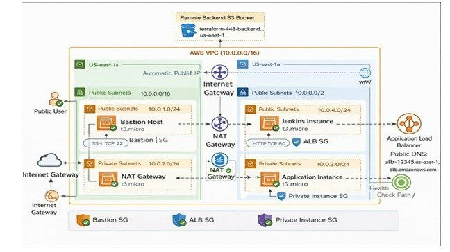

# AWS DevOps Infrastructure

## Project Overview

This project demonstrates a complete end-to-end DevOps workflow on Amazon Web Services (AWS). It showcases Infrastructure as Code (IaC), configuration management, containerization, and Continuous Integration/Continuous Deployment (CI/CD) by automating the provisioning and deployment of a web application.

The infrastructure is provisioned using Terraform, configured using Ansible, containerized with Docker, and automated through Jenkins. The application is deployed inside private subnets behind an Application Load Balancer (ALB), following secure AWS architecture best practices.

---

# Architecture Diagram

The following diagram illustrates the AWS infrastructure and deployment workflow used in this project.



---

# Project Features

- Provisioned complete AWS infrastructure using Terraform
- Created a custom VPC with public and private subnets
- Configured Internet Gateway and NAT Gateway
- Implemented secure network segmentation using Security Groups
- Deployed Bastion Host for secure SSH access
- Provisioned Jenkins and Application servers inside private subnets
- Configured Application Load Balancer (ALB) for external access
- Automated Docker installation using Ansible playbooks
- Built and deployed a containerized Node.js application using Docker
- Automated application deployment through Jenkins CI/CD pipeline
- Stored Terraform state remotely using Amazon S3
- Followed Infrastructure as Code (IaC) and DevOps best practices

---

# Technology Stack

| Category | Technology |
|-----------|------------|
| Cloud Platform | AWS |
| Infrastructure as Code | Terraform |
| Configuration Management | Ansible |
| Containerization | Docker |
| CI/CD | Jenkins |
| Compute | Amazon EC2 |
| Networking | VPC, Subnets, Route Tables, Internet Gateway, NAT Gateway |
| Load Balancer | Application Load Balancer (ALB) |
| Security | IAM, Security Groups |
| Remote State | Amazon S3 Backend |
| Operating System | Linux |
| Version Control | Git & GitHub |

---

# Architecture Components

### Networking

- Custom VPC
- Public Subnets
- Private Subnets
- Internet Gateway
- NAT Gateway
- Route Tables
- Security Groups

### Compute

- Bastion Host
- Jenkins Server
- Application Server

### DevOps Services

- Terraform
- Ansible
- Docker
- Jenkins

---

# Project Workflow

1. Terraform provisions the AWS infrastructure.
2. A custom VPC with public and private subnets is created.
3. Bastion Host, Jenkins Server and Application Server are deployed.
4. Ansible installs and configures Docker on the target servers.
5. Jenkins automates the application build and deployment process.
6. Docker builds and deploys the application.
7. The Application Load Balancer routes incoming traffic to the application server.
8. Users securely access the application through the ALB while backend servers remain inside private subnets.

---

# Repository Structure

```text
aws-devops-infrastructure
│
├── terraform/
├── ansible/
├── screenshots/
│   ├── architecture-diagram.jpg
│   ├── alb.png
│   ├── ec2.png
│   ├── jenkins.png
│   └── vpc.png
│
├── Dockerfile
├── Jenkinsfile
├── package.json
├── server.js
└── README.md
```

---

# Infrastructure Highlights

- Infrastructure fully provisioned using Terraform
- Remote Terraform state stored in Amazon S3
- Secure multi-tier AWS architecture
- Private EC2 instances protected from direct internet access
- Bastion Host used for secure administration
- Jenkins configured for CI/CD automation
- Docker-based application deployment
- Application exposed securely through an Application Load Balancer

---

# Screenshots

The repository includes screenshots demonstrating the deployment process.

- AWS Architecture Diagram
- VPC Configuration
- EC2 Instances
- Jenkins Dashboard
- Application Load Balancer

---

# Skills Demonstrated

- Amazon Web Services (AWS)
- Terraform
- Infrastructure as Code (IaC)
- Ansible
- Docker
- Jenkins
- CI/CD
- Linux Administration
- Bash Scripting
- Git & GitHub
- VPC Networking
- EC2
- Security Groups
- NAT Gateway
- Internet Gateway
- Application Load Balancer
- Infrastructure Automation

---

# Project Outcome

Successfully designed and deployed a secure AWS infrastructure using Infrastructure as Code and DevOps automation tools. The project demonstrates provisioning, configuration management, containerization and CI/CD implementation while following AWS networking and security best practices.

---

# Note

AWS resources were terminated after project completion to avoid unnecessary cloud costs. The infrastructure can be recreated anytime using the Terraform and Ansible configurations available in this repository.
